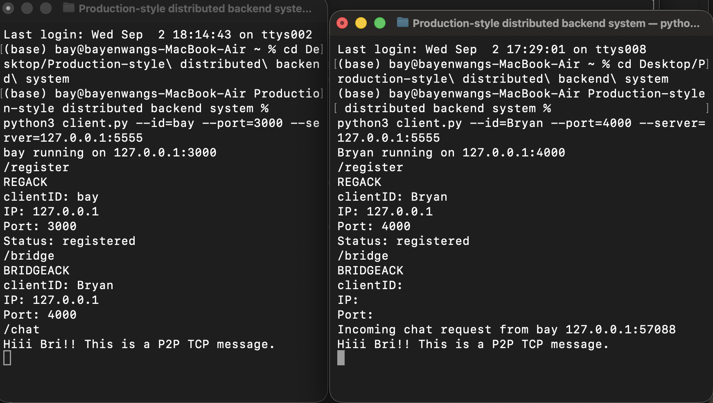
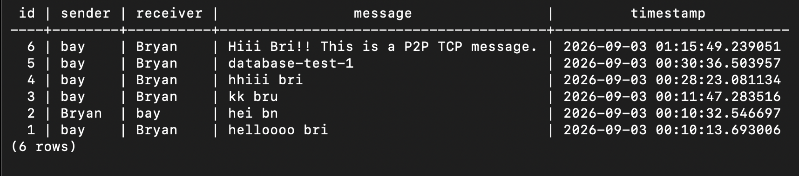
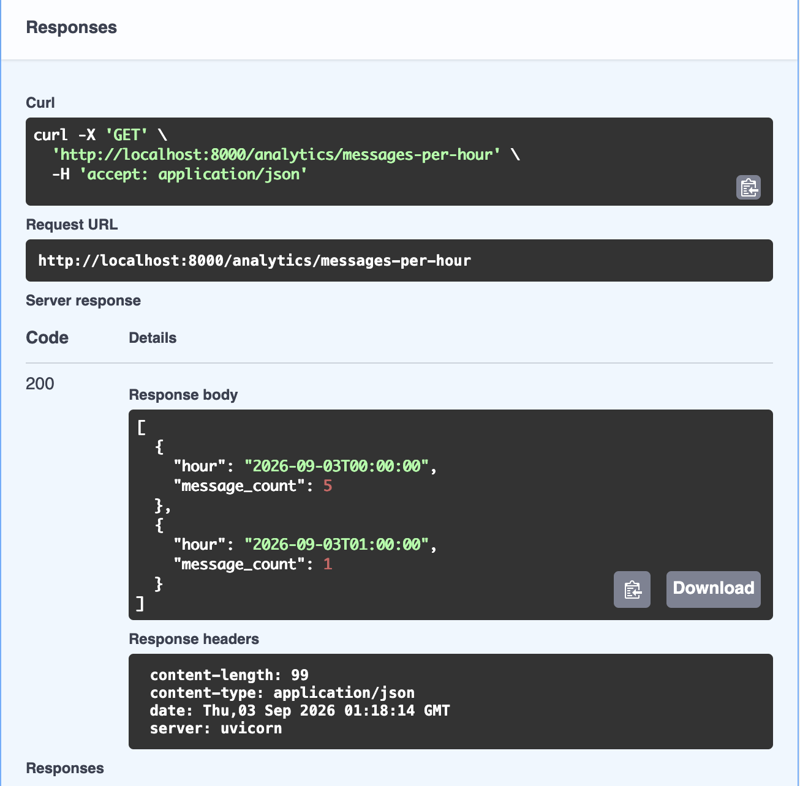
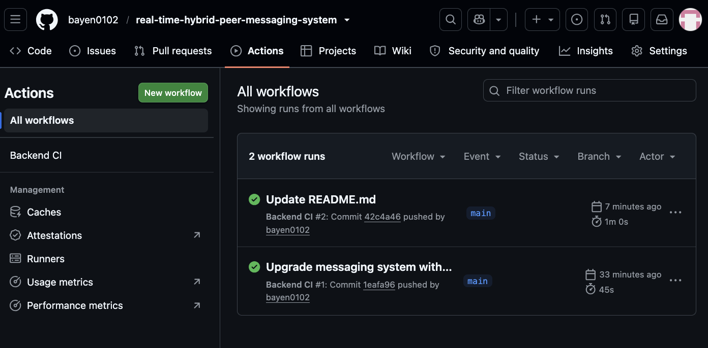

# Real-Time Hybrid Peer-to-Peer Messaging System

## Overview

This project is a multi-service backend system built around a hybrid peer-to-peer messaging architecture.

A centralized TCP coordination service handles client registration and peer discovery, while clients establish persistent peer-to-peer TCP connections for real-time messaging. The original SQLite-based messaging prototype was extended with PostgreSQL for persistent storage, Redis for user presence, FastAPI for management and analytics APIs, structured JSON logging, automated testing with pytest, Docker-based service orchestration, and GitHub Actions CI.

The system demonstrates:

- Real-time peer-to-peer TCP messaging
- Centralized client registration and peer discovery
- PostgreSQL-backed message persistence
- Redis-based user presence management
- EST API access through FastAPI (6 endpoints)
- Message analytics and aggregation, with a timestamp index and a time-window filter
- Structured JSON event logging
- Automated testing with pytest
- Multi-service orchestration with Docker Compose
- Continuous integration with GitHub Actions
- A reproducible local benchmark for the analytics query

---

## Key Networking Concepts

- Persistent TCP connections
- Peer-to-peer communication
- Client-server coordination
- Application-layer protocol design
- Concurrent socket I/O using `select()`
- Message persistence

---

## Architecture

```text
```text
┌──────────────────────┐                                ┌──────────────────────┐
│       Client A       │◄───── Persistent P2P TCP ─────►│       Client B       │
│  Alice (port 3000)   │                                │   Bob (port 4000)    │
└──────────┬───────────┘             (CHAT)             └───────────┬──────────┘
           │                 REGISTER / BRIDGE / LOG                │
           └──────────────────┐                    ┌────────────────┘
                              ▼                    ▼
                      ┌────────────────────────────────────┐
                      │  TCP Coordination Server (:5555)   │
                      │  select() + custom text protocol   │
                      │   REGISTER BRIDGE CHAT LOG QUIT    │
                      └───────┬────────────────────┬───────┘
                              │                    │
               ┌──────────────┘                    └───────────────┐
               ▼ save clients & messages          set user online  ▼
  ┌────────────────────────┐                          ┌────────────────────────┐
  │       PostgreSQL       │                          │         Redis          │
  │   clients · messages   │                          │     user presence      │
  └────────────┬───────────┘                          └────────────┬───────────┘
               │ query                                   presence  │
               └──────────────┐                    ┌───────────────┘
                              ▼                    ▼
                      ┌────────────────────────────────────┐
                      │ FastAPI Management / Analytics API │
                      │      6 REST endpoints (:8000)      │
                      └────────────────────────────────────┘

Docker Compose runs: TCP server, FastAPI, PostgreSQL, Redis. Clients run locally.
```
```
Redis stores user presence, which the FastAPI service reads through `/presence/{user_id}`.
Backend services are containerized and orchestrated using Docker Compose.

---

## Client State Machine

```text
INIT
  ├── /register
  ├── /bridge
  ▼
WAIT
  ├── listen()
  ├── accept()
  ▼
CHAT
  ├── persistent TCP messaging
  ├── LOG messages
  └── /quit
```

---

## Technologies

### Backend

- Python
- FastAPI
- TCP Socket Programming
- Custom Application-Layer Protocol

### Data

- PostgreSQL
- Redis

### Networking

- Peer-to-Peer TCP Communication
- I/O Multiplexing with `select()`
- Client-Server Coordination

### Testing & Infrastructure

- pytest
- Docker
- Docker Compose
- GitHub Actions

---

## Features

- Persistent peer-to-peer TCP communication
- Centralized peer registration and discovery
- Concurrent socket monitoring using `select()`
- PostgreSQL-backed client and message persistence
- Redis-based user presence tracking
- FastAPI management and analytics endpoints
- Message history retrieval through REST APIs
- Messages-per-hour analytics with an optional recent-window filter
- Structured JSON event logging
- Automated API and Redis testing with pytest
- Containerized PostgreSQL, Redis, API, and TCP services
- Automated CI testing with GitHub Actions
- Timestamp index on messages for time-range queries
- Reproducible local benchmark scripts

---

## Application Protocol

The system implements a custom text-based application protocol supporting:

```text
REGISTER
BRIDGE
CHAT
LOG
QUIT
```

Each protocol message uses CRLF-based headers over TCP streams.

---

## REST API

The FastAPI management service exposes persisted messaging data, presence, and analytics through HTTP endpoints.

| Method | Path | Description |
|---|---|---|
| GET | `/` | API health/status |
| GET | `/users` | Registered clients (id, IP, port) |
| GET | `/messages` | Full persisted message history |
| GET | `/messages/{user_id}` | Messages sent or received by one user |
| GET | `/analytics/messages-per-hour` | Message counts aggregated by hour (optional `hours` filter) |
| GET | `/presence/{user_id}` | Presence status of a user, read from Redis |

### Health Check

```http
GET /
```

Returns the status of the management API.

Example response:

```json
{
  "status": "ok",
  "service": "Messaging Management API"
}
```

### Message History

```http
GET /messages
GET /messages/{user_id}
```

Returns persisted message history from PostgreSQL. The second form returns only messages where the user is the sender or the receiver.

### Messages Per Hour

```http
GET /analytics/messages-per-hour
GET /analytics/messages-per-hour?hours=24
```

Aggregates stored messages by hour. The optional `hours` parameter (an integer of at least 1) limits the result to the most recent N hours, which lets the query use the timestamp index.

### Users

```http
GET /users
```

Returns registered clients (client id, IP, and port).

### Presence

```http
GET /presence/{user_id}
```

Returns the presence status of a user, read from Redis.
---

## Testing and Continuous Integration

The project uses pytest for automated backend testing. The suite has 6 tests and reaches 91% coverage on api.pyandredis_client.py (measured locally). It covers:

- API health checks
- Message history retrieval
- Message analytics, including the hours filter- Redis user presence

GitHub Actions automatically runs the test suite on pushes and pull requests.

The CI environment:

1. Starts PostgreSQL and Redis service containers
2. Initializes the PostgreSQL schema
3. Installs Python dependencies
4. Runs the pytest test suite

This ensures backend changes are automatically validated before integration.

---
## Benchmark

Local benchmark of the hourly aggregation query and the `GET /analytics/messages-per-hour?hours=24` endpoint, with and without the timestamp index (`idx_messages_timestamp`, defined in `database/schema.sql`).

### Setup

```bash
pip install -r requirements.txt
docker compose up --build -d
python scripts/seed_messages.py           # insert 100K synthetic messages
python scripts/benchmark.py               # run the benchmark and print a results table
python scripts/seed_messages.py --clean   # remove the synthetic messages
```

The scripts connect to PostgreSQL as exposed by `compose.yaml` on the host (`localhost:5434`, database `messaging_db`). Override with the `DB_HOST`, `DB_PORT`, `DB_NAME`, `DB_USER`, `DB_PASSWORD`, and `API_URL` environment variables.

### What is measured

- The SQL behind `get_messages_per_hour(hours=24)`, run directly against PostgreSQL (messages grouped by hour over the last 24 hours).
- The `/analytics/messages-per-hour` endpoint, measured end to end over HTTP, with and without the `hours` filter.
- Each figure is the median of 200 runs after 20 warm-up runs, with the index dropped and then recreated. The script restores the index when it finishes.

### Results (local, 100K synthetic messages spread over 30 days)

| Measurement | Without index | With index |
|---|---|---|
| Time-range aggregation query (SQL, last 24 h) | 5.7 ms | 1.0 ms |
| `GET /analytics/messages-per-hour?hours=24` (median) | 10.4 ms | 5.7 ms |
| `GET /analytics/messages-per-hour` (no filter, full table) | 19.6 ms | 20.5 ms |

Without the `hours` filter the query scans the whole table, so the index does not help. Figures come from one local machine running Docker Compose and will vary with hardware and data distribution.

---

## Running the System

### Start Backend Services

```bash
docker compose up --build
```

Docker Compose starts:

- TCP coordination server on port `5555`
- FastAPI management service on port `8000`
- PostgreSQL (host port 5434)
- Redis (host port 6380)

To run the services in the background:

```bash
docker compose up -d
```

### Start Client A

```bash
python3 client.py --id=Alice --port=3000 --server=127.0.0.1:5555
```

Register the client and begin waiting for a peer:

```text
/register
/bridge
```

### Start Client B

```bash
python3 client.py --id=Bob --port=4000 --server=127.0.0.1:5555
```

Register and discover the waiting peer:

```text
/register
/bridge
/chat
```

After peer discovery through the coordination server, the clients establish a direct persistent TCP connection for real-time messaging.

---

## API Examples

Retrieve stored messages:

```bash
curl http://localhost:8000/messages
```

Retrieve messages-per-hour analytics for all time, or for the last 24 hours:

```bash
curl http://localhost:8000/analytics/messages-per-hour
curl "http://localhost:8000/analytics/messages-per-hour?hours=24"
```

Run the automated test suite:

```bash
pytest -v
```

---

## Demo

### Peer-to-Peer Messaging



### PostgreSQL Message Persistence



### FastAPI Message Analytics



### GitHub Actions CI



---

## Future Improvements

- AWS cloud deployment
- WebSocket-based web clients
- Multi-peer group messaging
- NAT traversal for peers across different networks
- End-to-end message encryption
- Authentication and authorization
- Improved Redis presence management with heartbeat-based expiration
- Distributed peer discovery
